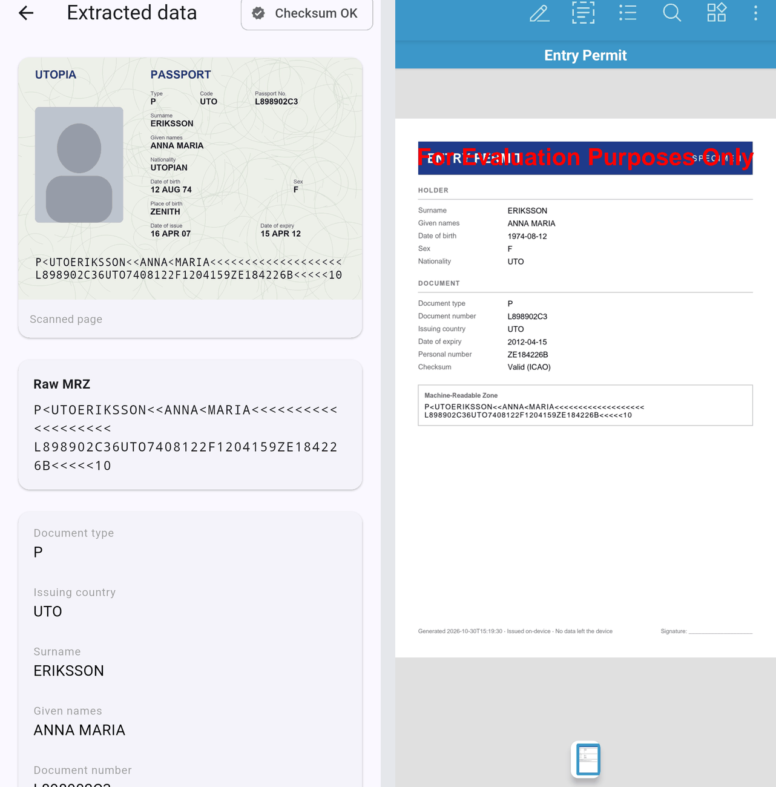
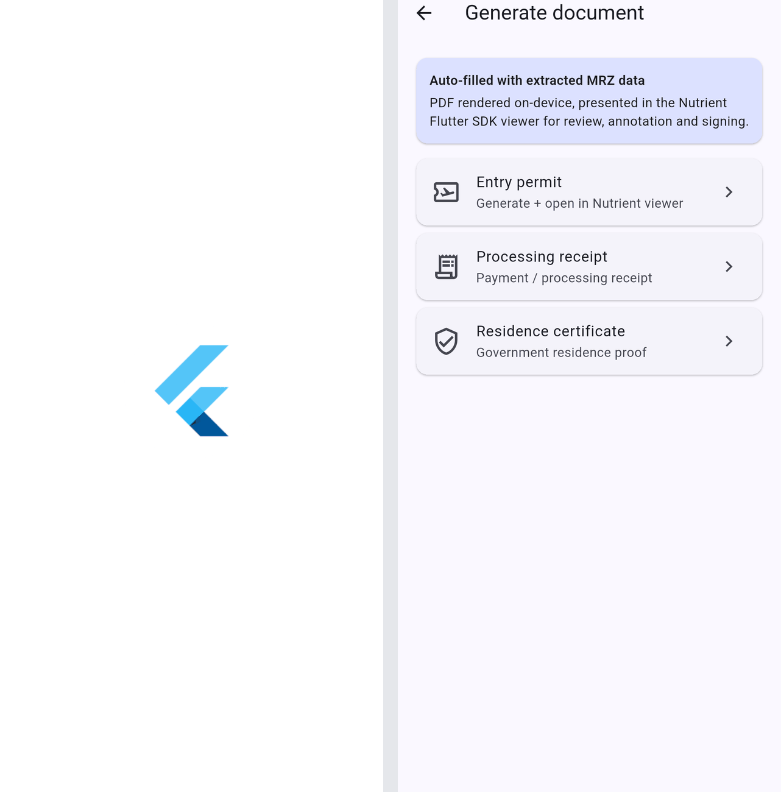

# Nutrient MRZ Capture for Flutter

A Nutrient.io demo, built with Flutter, that reads a passport MRZ on an Android device with the Nutrient Android OCR, then fills a generated document with the extracted data and opens it in the Nutrient Flutter SDK viewer.



1. **Image.** The app reads the bundled synthetic passport (`assets/samples/specimen_passport.jpg`). There is no camera capture in this demo.
2. **OCR.** A Kotlin method channel (`NutrientOcrBridge.kt`) wraps the image in a one-page PDF with `PdfProcessor`, runs `performOcrOnPages` with the English model of the `nutrient-ocr` module, and returns the page text to Dart.
3. **MRZ.** A Dart ICAO 9303 parser (`lib/services/mrz_parser.dart`) finds the MRZ lines (TD1, TD2 or TD3), fixes common OCR errors (fillers read as `K` or `L`, one extra character in the data line, digits and letters by position), parses the fields and checks the check digits.
4. **Review.** The result screen shows the image, the raw MRZ, every field and the checksum status.
5. **Document.** **Generate document** builds an entry permit, a processing receipt or a residence certificate as PDF with the `pdf` Dart package, filled with the MRZ data, and opens it with `Nutrient.present()` for viewing, annotating and signing.

Everything runs on the device. The main Android manifest declares no `INTERNET` permission (Flutter debug and profile builds add it for the tooling).

## Prerequisites

- Flutter 3.22 or later (Dart 3.4)
- Android SDK and JDK 17 or later
- An Android device or emulator (arm64 or x86_64)
- Access to the Nutrient Maven repository (`https://my.nutrient.io/maven/`), declared in `android/build.gradle.kts`
- Python 3 with Pillow, only to regenerate the specimen

Android only: the OCR bridge is written in Kotlin. An iOS host is not included.

## Environment variables

None. The Nutrient Flutter SDK and the Nutrient Android OCR start without a license key, in evaluation mode: the viewer and the generated documents carry a "For Evaluation Purposes Only" watermark, and the OCR reads the watermark too.

## Build and run

```bash
flutter pub get
```

```bash
flutter build apk --debug
```

```bash
flutter run -d android
```

## Using the app

1. Tap **Read the specimen passport**. The OCR takes a few seconds (longer on an emulator).
2. Check the extracted fields and the **Checksum OK** badge.
3. Tap **Generate document** and pick a document type. It opens in the Nutrient viewer, where you can annotate, sign and share it.

   

Screenshots were taken on an Android emulator in evaluation mode, with the bundled synthetic specimen.

## Specimen

`tools/make_specimen.py` draws the passport data page with the ICAO 9303 specimen data (state "Utopia", fictitious holder Anna Maria Eriksson). No real person or document is used.

```bash
python3 tools/make_specimen.py
```

The script uses the macOS Andale Mono and Arial fonts. On other systems, set `SPECIMEN_FONT_DIR` to a folder with the same `.ttf` files.

## Known limits

- The Nutrient OCR is a general-purpose OCR, not an MRZ engine. The Dart rules fix common errors, but names have no check digit and some images will not parse.
- The generated documents are simple layouts drawn with the `pdf` package, not AcroForm templates.

## Project layout

| Path | Content |
|---|---|
| `lib/screens` | Home, read, result and document generation screens |
| `lib/services/mrz_service.dart` | Method channel client |
| `lib/services/mrz_parser.dart` | ICAO 9303 parser and OCR fixes |
| `lib/services/document_service.dart` | PDF generation and the Nutrient viewer |
| `android/app/src/main/kotlin/io/nutrient/poc/mrzcapture` | Flutter activity and the Nutrient OCR bridge |
| `assets/samples` | Synthetic specimen |
| `tools/make_specimen.py` | Specimen generator |
